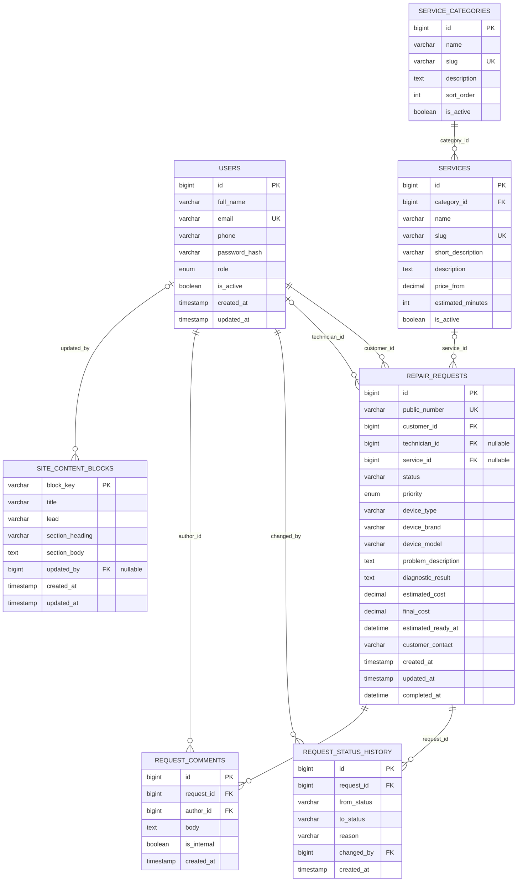

# FixPoint — агентский handoff и план финальной проверки

> **Срок сдачи Module 4: четверг, 19 ноября 2026.**
> Этот документ — актуальная точка входа для backend/coding agent и внешнего AI-агента.
> Не начинать переписывание проекта. Сначала проверить локальное состояние и продолжать существующую реализацию.

## 1. Текущий Git baseline (проверен 17 ноября 2026)

- Repository: https://github.com/MaxSC2/FixPoint (public).
- Рабочая QA-ветка: `qa/browser-visual-capture`.
- HEAD на момент аудита: `11c6d5a582b4b8648169231cac433f94459b3efc`.
- Интеграционная база: `develop` = `7a5f3f83752aca62c6d8add39dca8e05db481822`.
- `main` = `d1300d10ab4fc2f77bb2138d1336a2728fe25b4a`.
- PR #21: https://github.com/MaxSC2/FixPoint/pull/21 — OPEN, Draft, base `develop`, не слит.
- PR #9 (backend foundation) и PR #11–18 (основные задачи backend/UI) закрыты после merge в develop.
- Ветка `qa/browser-visual-capture` на момент сравнения была на 93 коммита впереди develop и не отставала. Не делайте reset/force-push и не считайте этот PR маленьким CSS-only diff: он несёт накопленный интегрированный функционал.
- `main` и `develop` не изменять напрямую. Merge PR без отдельного разрешения владельца запрещён.

### Последние подтверждённые проверки на одном HEAD

HEAD `11c6d5a582b4b8648169231cac433f94459b3efc`, 16 Nov 2026:

| Проверка | GitHub Actions | Результат |
|---|---|---|
| CI PHP 8.3 + MySQL 8 | https://github.com/MaxSC2/FixPoint/actions/runs/43905942977 | PASS: lint 138 files; 175 tests, 0 failed, 1715 assertions; smoke 30 checks |
| Docker Compose runtime | job внутри CI run выше | PASS |
| Browser Visual QA | https://github.com/MaxSC2/FixPoint/actions/runs/43905942899 | PASS: 139 captures; HTTP errors 0; horizontal overflow 0; axe violations 0; browser errors 0; fatal errors 0 |
| Module 4 source audit | https://github.com/MaxSC2/FixPoint/actions/runs/43905942915 | PASS: 56 DOCX paragraphs, 31 unique links; YouTube blocked all automated caption checks |

Скриншоты:
- Artifact: `fixpoint-visual-review-73` (ZIP, 27.1 MB, 14-day GitHub Actions retention).
- Открыть run: https://github.com/MaxSC2/FixPoint/actions/runs/43905942899 → Artifacts → `fixpoint-visual-review-73`.
- Визуальный прогон охватывает публичные страницы, customer, technician и admin маршруты, viewport 1440/1280/1024/768/390/360 px (где применимо).
- Это автоматизированные Chromium captures. Ручной осмотр всех 139 изображений не заявлять. Выборочно осмотрены главная, каталог, клиентский список/создание заявки на 360px, очередь и карточка мастера, админский реестр на 1024px, статистика, пользователи, услуги и редактор About на desktop.

**Расхождение документации:** более ранние записи в `docs/00-URGENT-MODULE-4-DEADLINE-2026-11-19.md` указывают SHA `bb27989`, `c4509cb` и `94a9090`, а также 1711 assertions. Это исторические результаты. На дату handoff актуальный проверенный HEAD — `11c6d5a`, а CI сообщает 1715 assertions. Обновить контрольный документ после нового финального прогона, не переписывая историю неудачных запусков.

## 2. Что это за продукт

FixPoint — учебная веб-система сервисного центра. Это не маркетплейс мастеров и не статический макет.

Основной процесс:
1. Клиент регистрируется и создаёт заявку на ремонт.
2. Администратор видит глобальный реестр и назначает активного мастера.
3. Мастер видит назначенные ему заявки, проводит диагностику, фиксирует смету и срок.
4. Клиент принимает или отклоняет смету.
5. Мастер ведёт ремонт, обновляет статусы и закрывает заявку.
6. История статусов и публичные комментарии остаются в карточке заявки.

Роли: `customer`, `technician`, `admin`.

## 3. Стек и архитектура

- PHP 8.3, MySQL 8, Apache, PDO, HTML5, CSS3, vanilla JavaScript.
- Docker Compose для воспроизводимого локального запуска.
- GitHub Actions: PHP/MySQL CI, Docker runtime, Playwright/Chromium visual QA, Module 4 DOCX/source audit.
- Никакого обязательного Node backend, SPA-фреймворка или внешнего API. Не добавлять зависимости без доказанной необходимости.

Поток запроса:

```text
Browser / HTTP
  -> public/index.php (Front Controller)
  -> Router (config/routes.php)
  -> Middleware (Auth / Role / CSRF / Security Headers)
  -> Controller
  -> Service (business rules)
  -> Repository (PDO prepared SQL)
  -> MySQL
  -> ViewRenderer -> app/Views/**/*.php -> HTML
```

Границы слоёв:
- SQL только в Repositories.
- Бизнес-правила и повторные проверки доступа — Services.
- Controllers тонкие, переводят HTTP в вызовы сервисов.
- Views не знают о PDO/SQL и не выполняют мутации.
- Все изменяющие запросы используют CSRF; права проверяются сервером.
- Сохранять существующий контракт `docs/10-INTEGRATION-CONTRACT.md` и шаблонный контракт `docs/16-VIEW-TEMPLATE-CONTRACT.md`.

## 4. Схема базы данных (фактические миграции 001–008)

Движок MySQL 8 / InnoDB / utf8mb4. PK — BIGINT UNSIGNED, время хранится в UTC. Схема создаётся forward-only миграциями `database/migrations/001..008`.

### ER diagram



### Связи простыми словами

- Один пользователь-клиент может создать много заявок: `repair_requests.customer_id -> users.id`.
- Один мастер может быть назначен на много заявок; до назначения `technician_id = NULL`.
- Одна категория содержит много услуг: `services.category_id -> service_categories.id`.
- У заявки может быть одна выбранная услуга или ни одной: `service_id` nullable.
- У заявки много событий истории: `request_status_history.request_id`; каждое событие имеет инициатора `changed_by -> users.id`.
- У заявки много комментариев: `request_comments.request_id`; каждый комментарий имеет автора.
- Блок публичного контента хранит пользователя, который последним изменил его; `updated_by` nullable.
- История статусов append-only по смыслу; смена статуса и запись истории выполняются в одной транзакции.
- `request_comments.is_internal=1` доступен только staff; клиентская выборка не должна раскрывать внутренние заметки.

### Что НЕ является частью текущей БД

Нет таблицы файлов/вложений, профилей компетенций мастера, AI-диагнозов, чата в реальном времени, push-токенов или автоматического matching. Фото-вложения и подбор мастера описаны только как future roadmap. Не создавать их в спешке перед сдачей, если это не требуется буквальным заданием и не будет полностью протестировано.

## 5. Функциональность и маршруты

### Public / auth
- `GET /`, `GET /services`, `GET /services/{slug}`, `GET /about`, `GET /contacts`, `GET /health`.
- `GET/POST /login`, `GET/POST /register`, `POST /logout`.
- Регистрация создаёт только customer; роли technician/admin назначает администратор.

### Customer
- `GET /account`
- `GET /requests`, `GET/POST /requests/create`
- `GET /requests/{id}`
- `POST /requests/{id}/comments`
- `POST /requests/{id}/estimate-decision`
- Клиент видит только свои заявки и публичные комментарии.

### Technician
- `GET /technician/requests` — очередь назначенных мастеру заявок.
- `GET /technician/requests/{id}`
- `POST /technician/requests/{id}/diagnosis`
- `POST /technician/requests/{id}/status`
- Мастер видит только назначенные ему заявки; чужая заявка должна быть скрыта ответом 404.

### Admin
- `GET /admin`, `GET /admin/statistics`
- Реестр/назначение: `GET /admin/requests`, `GET/POST /admin/requests/{id}/assign`.
- Пользователи: `GET/POST /admin/users`, `GET/POST /admin/users/{id}/edit`.
- Услуги: `GET/POST /admin/services`, `GET/POST /admin/services/{id}/edit`.
- Категории: `GET/POST /admin/categories`, `GET/POST /admin/categories/{id}/edit`.
- Контент: `GET/POST /admin/content/about`.
- Все admin маршруты защищены серверной ролью admin.

### Матрица статусов

```text
new -> accepted | rejected | cancelled
accepted -> diagnostics | cancelled
diagnostics -> awaiting_customer_approval | awaiting_parts | repairing | rejected
awaiting_customer_approval -> repairing | cancelled
repairing -> awaiting_parts | ready_for_pickup
awaiting_parts -> repairing
ready_for_pickup -> completed
completed / cancelled / rejected -> terminal (no transitions)
```

Единственный источник переходов — `app/Services/RequestStatusService.php`. Не дублировать матрицу в контроллерах или JS.

## 6. Визуальная система и скриншоты

Визуальный стиль: светлый тёплый нейтральный фон, тёмно-синие/графитовые тексты, синий акцент действий, карточки и аккуратные границы, единые контейнеры/отступы, умеренная анимация reveal. Основной desktop layout использует широкую сетку; мобильный интерфейс клиента имеет компактные списки, короткие действия и нижнюю навигацию с safe-area.

Ключевые скриншоты в артефакте `fixpoint-visual-review-73`:
- `public__home__desktop-1440.png`
- `public__services__desktop-1280.png`
- `customer-kovalev__requests__small-mobile-360__viewport.png`
- `customer-kovalev__requests-create__small-mobile-360__viewport.png`
- `technician-ivanov__technician-requests__desktop-1280.png`
- `technician-ivanov__technician-requests-1__desktop-1280.png`
- `admin__admin-requests__compact-1024.png`
- `admin__admin-statistics__desktop-1280.png`
- `admin__admin-users__desktop-1280.png`
- `admin__admin-services__desktop-1280.png`
- `admin__admin-content-about__desktop-1280.png`

Сначала открывать реальные screenshot files из artifact, а не генерировать новые макеты и не делать выводы по одному Lighthouse/axe числу. Визуальные изменения делать циклом: screenshot -> отметить конкретный дефект -> минимальный CSS/PHP fix -> browser capture -> сравнить -> CI. Не ломать backend контракт ради UI.

## 7. Точные приоритеты до сдачи (P0)

1. **Синхронизация фактов:** проверить локальный HEAD и GitHub HEAD; обновить `docs/00-URGENT-MODULE-4-DEADLINE-2026-11-19.md`, чтобы верхняя секция и таблица сборок называли актуальный commit/run. Исторические красные сборки не удалять.
2. **Проверка реального локального запуска:** чистый/существующий checkout, `docker compose up --build`, health, миграции, seed. Не перезаписывать пользовательский .env/данные. Для native startup использовать README.
3. **Ручной end-to-end браузерный проход** в отдельных сессиях customer/admin/technician: клиент создаёт заявку -> admin назначает -> technician принимает/диагностирует/формирует смету -> customer соглашается -> technician доводит до ready_for_pickup/completed -> customer видит финал и историю.
4. **Негативные проверки безопасности:** гость -> /admin redirect; customer -> /admin 403; клиент/мастер не видят чужую заявку (404); customer не может создать internal note даже подделав `is_internal=1`; внутренние заметки скрыты в customer response; POST без CSRF -> 419; недопустимый переход и терминальная заявка не изменяются.
5. **Формы/UX:** пустые и некорректные данные, сохранение old input после ошибок, доступность клавиатуры, focus, ошибки понятны, mobile 360/390 и desktop 1024/1280/1440.
6. **DB proof:** показать миграции, реальные связи, demo data, историю и комментарии. Не запускать `--fresh` против не-тестовой БД.
7. **Финальная регрессия:** PHP lint, tests/run.php, smoke, CI + Docker + Browser QA + source audit на одном точном HEAD. Записать результаты в docs и Issue #22.
8. **Защита:** проверить README и `docs/27-MODULE-4-DEFENCE-NOTES.md`, `docs/28-MANUAL-DEFENCE-RUNBOOK.md`; темы трёх видео задания №9 зафиксированы по машинным транскриптам в `docs/32` — это темы уроков, а не отдельные критерии DOCX. Live caption check зависит от IP/времени: локально 18.11.2026 — `available=31`, предыдущий CI — `blocked_by_youtube` (unverified, не absent). Локальный пакет `ru.vtt`/`ru.txt` структурно провалидирован. Ручной просмотр человеком не заявлять.

### Не расширять scope перед сдачей без необходимости

Не добавлять сейчас фото upload, AI triage, автоматический подбор мастера, real-time chat, push или полный каталог моделей/брендов. Эти идеи полезны для roadmap, но требуют хранения, авторизации, миграций, тестов и защиты. В рамках оставшегося времени приоритет — корректность существующего сценария и доказуемая готовность Module 4.

## 8. Инструкции coding agent — обязательный порядок

1. Сначала сообщить `pwd`, `git status --short --branch`, `git branch --show-current`, `git log -5 --oneline --decorate`, `git remote -v`, `git rev-parse HEAD`. Сопоставить с GitHub HEAD.
2. **Если рабочее дерево dirty или есть локальные коммиты, не делать reset, clean, checkout поверх, stash, rebase или force-push.** Сначала перечислить изменения и сохранить их; согласовать безопасное продолжение. Не удалять и не перезаписывать файлы агента.
3. Прочитать этот handoff, Issue #22, PR #21, README, docs 00/02/04/05/08/09/10/16/27/28 и оригинальный DOCX.
4. Составить короткий gap report: что уже реально работает, что только описано, что сломано, что можно успеть до дедлайна. Сверить код, БД, тесты и UI.
5. Работать отдельной веткой от актуального QA HEAD (если нет незакоммиченной локальной работы). Не пушить напрямую в main/develop. Не мерджить PR #21.
6. Перед изменением общей схемы/контрактов прочитать migrations, repositories, services и тесты. Только forward migration; не редактировать старые уже применённые миграции без крайней причины.
7. Любой найденный баг воспроизвести тестом, исправить минимально, добавить регрессионный тест и снять свежий скриншот, если он влияет на UI.
8. Не заявлять «ручной тест пройден», если браузер реально не управлялся человеком/агентом. Не подменять скриншоты мокапом.
9. Перед коммитом перечислить изменённые файлы, команды и результаты. После push дождаться всех трёх workflow на exact HEAD.
10. В конце дать: commit SHA, PR URL, точные тестовые результаты, список ручных сценариев и ограничения. Merge не выполнять.

## 9. Полезные GitHub ссылки

- Repo: https://github.com/MaxSC2/FixPoint
- Deadline Issue #22: https://github.com/MaxSC2/FixPoint/issues/22
- Current Draft PR #21: https://github.com/MaxSC2/FixPoint/pull/21
- Branch: https://github.com/MaxSC2/FixPoint/tree/qa/browser-visual-capture
- Actions: https://github.com/MaxSC2/FixPoint/actions
- Current CI run: https://github.com/MaxSC2/FixPoint/actions/runs/43905942977
- Current visual artifact run: https://github.com/MaxSC2/FixPoint/actions/runs/43905942899
- Current source audit: https://github.com/MaxSC2/FixPoint/actions/runs/43905942915
- Original assignment: https://github.com/MaxSC2/FixPoint/blob/qa/browser-visual-capture/assignment/%D0%9C%D0%BE%D0%B4%D1%83%D0%BB%D1%8C%204.docx
- Module 4 mapping: https://github.com/MaxSC2/FixPoint/blob/qa/browser-visual-capture/docs/02-MODULE-4-MAPPING.md
- DB design: https://github.com/MaxSC2/FixPoint/blob/qa/browser-visual-capture/docs/04-DATABASE-DESIGN.md
- Integration contract: https://github.com/MaxSC2/FixPoint/blob/qa/browser-visual-capture/docs/10-INTEGRATION-CONTRACT.md
- Defence notes: https://github.com/MaxSC2/FixPoint/blob/qa/browser-visual-capture/docs/27-MODULE-4-DEFENCE-NOTES.md
- Manual runbook: https://github.com/MaxSC2/FixPoint/blob/qa/browser-visual-capture/docs/28-MANUAL-DEFENCE-RUNBOOK.md

## 10. Финальный критерий готовности

Сдавать можно, когда: (a) проект запускается на ПК с нуля/по README; (b) сквозной процесс работает в браузере; (c) роли, владение заявками, CSRF и внутренние заметки проверены; (d) БД и связи можно объяснить; (e) мобильные и desktop страницы читаемы; (f) все workflows зелёные на одном HEAD; (g) документы и ответы соответствуют оригинальному DOCX; (h) владелец понимает оставшиеся ограничения.

**Владелец проекта не разрешал merge. Сохранить PR в Draft до отдельного решения.**

---

## 11. Финальный аудит 17 ноября 2026 - фактический статус

**Проверенный код-HEAD:** `979795b` (merge ветки PR #21 `6b36ee0` с фиксами `2d114ac`, `4a9bd94`, `4c8e74d`). Все локальные проверки ниже выполнены на этом коде; документационная запись идёт поверх без изменения кода.

### Локальные результаты

| Проверка | Результат |
|---|---|
| PHP lint | 138/138 файлов OK |
| PHPUnit-совместимый runner | 186 passed, 0 failed, 1876 assertions |
| HTTP smoke | 30/30 |
| Миграции | `migrate.php --fresh`: применены 8 миграций |
| Seed | 6 пользователей, 4 заявки, 15 событий истории, 5 комментариев |

### Подтверждено в браузере

- Полный жизненный цикл `FP-2026-000081`: клиент → админ → мастер → клиент → мастер → клиент; 7 переходов истории.
- Подписи допустимых переходов в карточке мастера непустые и совпадают со статусами.
- Внутренняя заметка видна мастеру и администратору, клиенту — нет.
- Негативные проверки: чужая заявка 404; клиент на `/admin` и `/technician/requests` 403; POST без CSRF 419; терминальная заявка без доступных переходов.
- Адаптив проверен на 360/390/768/1024/1280/1440 px для статистики, карточки мастера, финальной карточки клиента и админ-дашборда.

### Исправленные дефекты этого прохода

1. `MigrationTest.php` в PR #21 не содержал `<?php` — тесты миграций не выполнялись. Добавлены guard в `tests/run.php` и проверка `<?php` в `tests/lint.php`.
2. `status-badge.php` перезаписывал `$statusLabels` — переходы и текущий статус в карточке мастера были без подписей. Переменные переименованы, добавлены регрессионные assert'ы.
3. Пункт «Контент» отсутствовал в admin-навигации на 9 страницах. Навигация унифицирована, добавлен тест на всех admin-маршрутах.
4. Статистика 005D интегрирована с `periodError`, месячными пропусками и топом услуг.
5. Каталог услуг: блок поиска/фильтра выглядел как три вложенные рамки, а на ≤900 px ломался (`flex: 1 1 420px` в колоночном режиме давал высоту 420 px). Внешняя панель убрана, стили вложенных input/select сброшены, добавлен `focus-within`; проверено на 360/390/768/1024/1440 px.

### Расшифровка видео (17.11.2026, уточнено 18.11.2026)

- Все 31 уникальное видео из DOCX имеют локальные `ru.vtt` и `ru.txt`: `assignment/subtitles/` (плюс `full-transcript.md`, `README.md`, `_index.json`). Валидатор: 15 411 реплик, 39 627 слов TXT (в индексе 39 001), 0 ошибок, 7 предупреждений.
- Три видео задания №9 опознаны по машинным транскриптам: редактирование текстов страниц, защита админки Basic Auth, финальный урок о переносе БД на хостинг. Это темы уроков, а не отдельные функциональные критерии DOCX.
- Разбор, разделение требований/тем уроков/реализации и мета-тегов — `docs/32-ASSIGNMENT-VIDEOS-TRANSCRIPTS-2026-11-17.md`.
- Валидатор: `scripts/assignment/validate_transcripts.py`, тесты: `scripts/assignment/tests/`, отчёты: `artifacts/module4/transcript-validation.{json,md}`.
- Права на публикацию полного текста — `docs/35-TRANSCRIPT-RIGHTS-2026-11-18.md`; решение за владельцем.
- Ограничение: текст машинный; ручной просмотр 31 видео человеком не подтверждён; live-эндпоинт YouTube остаётся blocked/unverified.

### Ограничения

- `final_cost` не записывается приложением; итоговая стоимость у реальных заявок — «Не определена».
- Docker Compose доступен только в CI; локального Docker нет.
- AI-диагностика, auto-assign, real-time chat, push, фото и полный каталог моделей не реализованы.
- Merge PR #21 и синхронизация `main` — только с разрешения владельца.
- Расхождение с курсом (не P0): `meta description` в лейауте статический; из текстов страниц редактируется только «О нас».
